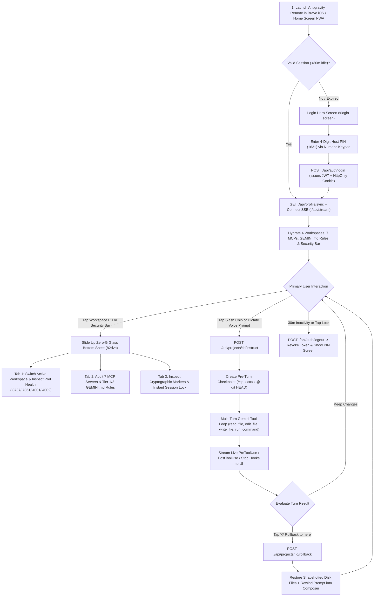

# Antigravity Remote — Comprehensive Product Design & Mobile UX Brief

**Version:** `1.1.0`  
**Product:** Antigravity Remote (Official Mobile Companion to the Antigravity Agentic IDE)  
**Primary Client:** Brave Browser on iOS (iPhone Retina Viewport & Standalone Home Screen PWA)  
**Live Edge Endpoints:** `https://removeback.gd/antigravity/` · `https://binaryday.app/antigravity/`  
**Source Implementation:** [`public/index.html`](../public/index.html) · [`src/icons.ts`](../src/icons.ts) · [`src/profileSync.ts`](../src/profileSync.ts) · [`src/agentEngine.ts`](../src/agentEngine.ts) · [`src/store.ts`](../src/store.ts) · [`src/server.ts`](../src/server.ts)

---

## 1. Product Vision, Target Persona & Core UX Problem Statement

### 1.1 Who This Product Is Built For
**Primary Persona:** The Principal Systems Architect / Autonomous Developer (`jbb@avilo.capital`) operating a multi-project compute cluster (`RemoveBackGround`, `BinaryDay`, `SnapCal`, `AntigravityRemote`) on a dedicated Vast.ai GPU node (`85.10.218.46:44016`) connected to 7 external MCP servers (`Vast.ai`, `Cloudflare`, `OVH`, `GitHub`, `Stitch`, `Resend`, `Stripe`).

When away from the desktop workstation, the user does **not** want a cramped mobile code editor or a brittle SSH terminal where a typo can crash production. Instead, the user needs a **high-trust, voice-first, one-thumb mobile command deck** inside **Brave Browser on iOS** to:
1. **Monitor** live cluster health, port status (`:8787`, `:7861`, `:4001`, `:4002`), GPU VRAM isolation (`cuda:0`), and active MCP tool telemetry at a glance.
2. **Dispatch** natural-language voice instructions or one-tap slash workflows (`/start`, `/update-memory`, `/plan`, health audits) that execute **real workspace tools** (`read_file`, `edit_file`, `write_file`, `run_command`) on the server.
3. **Verify & Undo** any agentic action instantaneously with **One-Tap Antigravity Checkpoints & Rollbacks (`↺ Rollback to here`)** that revert modified disk files and rewind the prompt back into the mobile composer.
4. **Stay Protected** via visible cryptographic identity/security markers and an automatic **30-minute sliding inactivity lock**.

### 1.2 The Five Mobile Engineering Failures Antigravity Remote Solves

| # | Traditional Mobile IDE / SSH Failure | Antigravity Remote UX Solution |
| :-: | :--- | :--- |
| **1** | **Manual Setup Friction:** Typing repo paths, API keys, MCP configs, or system rules on an iPhone screen is unusable. | **Zero-Config Gemini Profile Hydration:** Entering the 4-digit Host PIN (`1631`) auto-discovers all 4 colocated workspaces, 7 MCP servers, and Tier 1/2/3 `GEMINI.md` rules from the host. |
| **2** | **iOS Keyboard & Address Bar Jumps:** Opening the iOS keyboard, dictation waveform, or collapsing Brave's URL bar shifts `100vh` layouts and pushes headers off-screen. | **`visualViewport` Pinning Engine:** `#app-shell` dynamically binds `top: var(--vvo)` and `height: var(--vvh)` via `window.visualViewport` `resize` and `scroll` events. |
| **3** | **Glass-Key Typing Fatigue:** Typing file paths and multi-sentence specs with thumbs is slow and error-prone. | **Voice-First Composer + Hydrated Slash Chips:** Native iOS microphone dictation (`16px` anti-zoom textarea + inline `Clear` pill) paired with 6 one-tap workflow chips. |
| **4** | **Opaque Chat vs. Unsafe Mutation:** Remote chat apps either hallucinate actions without touching files, or mutate files with no mobile undo path. | **Real Tool Loop + One-Tap Rollbacks:** Executes real sandboxed tools (`read_file`, `edit_file`, `write_file`, `run_command`) with pre-turn `#cp-xxxxxx` file snapshots and one-tap `↺ Rollback to here`. |
| **5** | **Brave Shields, Tab Suspension & Unattended Devices:** Brave blocks cross-site state; iOS kills background SSE sockets; unlocked phones pose security risks. | **Same-Origin Subpath Routing + Foreground Re-Sync + 30m Auto-Logout:** Strict `./api/*` relative calls, automatic `visibilitychange` SSE recovery, and dual client/server `1800s` sliding session lock. |

---

## 2. Visual & Spatial Design System ("Zero-G Glass")

Antigravity Remote shares the official visual DNA of the desktop Antigravity IDE, adapted for high-contrast outdoor/mobile legibility on OLED iPhone displays.

### 2.1 Atmospheric Color & Surface Hierarchy
- **Deep Void Obsidian Canvas (`--bg-void: #07080C`):** True OLED-friendly dark foundation paired with a top radial ambient glow (`rgba(124, 58, 237, 0.14)` → `rgba(79, 70, 229, 0.07)` → `rgba(56, 189, 248, 0.03)`).
- **Zero-G Glass Surfaces (`--glass-surface: rgba(15, 17, 26, 0.85)` / `--glass-elevated: rgba(22, 25, 38, 0.92)`):** `backdrop-filter: blur(20px)` to `blur(28px)` with `1px solid #1E2235` structural borders and `inset 0 1px 0 0 rgba(255, 255, 255, 0.08)` top-edge specular refraction.
- **Antigravity Prism Gradient (`--prism-gradient`):** `linear-gradient(135deg, #7C3AED 0%, #4F46E5 50%, #38BDF8 100%)` reserved for primary interactive focal points (Send button, Login CTA, active Bottom Sheet tab, and official Delta-Prism logo).
- **Semantic Orbital Status Dots (`.orbital-dot`):**
  - **`Idle` (`#38BDF8` Orbital Cyan):** Static `8px` cyan glow; workspace synced and ready.
  - **`Running` (`#A855F7` Plasma Purple):** `1.2s` infinite breathing pulse (`scale(1)` → `scale(1.45)`); Gemini tool loop actively executing.
  - **`Completed` (`#10B981` Emerald Verify):** Healthy service probe or completed tool turn.
  - **`Blocked` (`#F43F5E` Alert Rose):** Tier 2 guardrail violation, unreachable port, or expired auth.

### 2.2 Viewport Zoning & One-Thumb Ergonomic Map

The entire interface is locked inside a non-scrolling fixed frame (`position: fixed; top: var(--vvo); height: var(--vvh)`) divided into four vertical zones designed for one-handed iPhone operation:

```
+-------------------------------------------------------------------+
| [Safe-Area Top Inset: Dynamic Island / Notch]                     |
|-------------------------------------------------------------------|
| ZONE 1: PERSISTENT TOP NAVIGATION BAR (.top-nav, pad-x: 24px)     |
| [ (A) AntigravityRemote ● | git:main | 7 MCPs ▾ ]   [ ↻ ] [ 🔒 ] |
|-------------------------------------------------------------------|
| ZONE 2: SECURITY & IDENTITY BAR (.security-bar, pad-x: 24px)      |
| [ 👤 jbb@avilo.capital · mac-mighty-vertex ] [ 🛡️ TLS 1.3 ] [⏱30:00]|
|===================================================================|
| ZONE 3: INDEPENDENTLY SCROLLABLE STREAM (.stream-container)       |
| +---------------------------------------------------------------+ |
| | [SYNCED] ~/.gemini/GEMINI.md • Vast.ai (85.10.218.46:44016)   | | <-- Live Hook Strip
| +---------------------------------------------------------------+ |
|                                                                   |
|                 +-----------------------------------------------+ |
|                 | YOU · BRAVE iOS                         18:10 | | <-- User Prompt Card
|                 | Update activeContext.md with our security...  | |     (Prism Tint, Right)
|                 | - - - - - - - - - - - - - - - - - - - - - - - | |
|                 | ⚓ #cp-d9b52a · 1540638   [ ↺ Rollback to here]| |
|                 +-----------------------------------------------+ |
|                                                                   |
| +---------------------------------------------------------------+ |
| | ANTIGRAVITY · GEMINI-3.5-FLASH                          18:10 | | <-- Assistant Turn Card
| | ### Summary of Changes                                        | |     (Zero-G Glass, Full)
| | - Updated `memory-bank/activeContext.md` with policy.         | |
| | ------------------------------------------------------------- | |
| | ● [PreToolUse] Running read_file(memory-bank/activeContext.md)| | <-- Collapsible/Stacked
| | ● [PostToolUse] Edited memory-bank/activeContext.md           | |     Tool Trace List
| | ● [Stop] Completed turn (2 tool calls)                        | |
| | - - - - - - - - - - - - - - - - - - - - - - - - - - - - - - - | |
| | ⚓ #cp-d9b52a · 1540638 (1 file snapshotted) [↺ Rollback here] | | <-- Checkpoint Footer
| +---------------------------------------------------------------+ |
|===================================================================|
| ZONE 4: VOICE-FIRST COMPOSER DOCK (.composer-dock, pad-x: 24px)   |
| [✦ /start · Bootstrap] [✦ Verify Health] [✦ Audit GPU] ...       | <-- 24px-Inset Chip Row
| +----------------------------------------------------+  +-------+ |
| | Dictate or type instruction...             [Clear] |  |   ➤   | | <-- 16px Anti-Zoom Input
| +----------------------------------------------------+  +-------+ |     + 44x44 Prism Send
| [Safe-Area Bottom Inset: iOS Home Indicator]                      |
+-------------------------------------------------------------------+
```

---

## 3. Detailed User Journeys & Interactive Workflows



---

### Journey 1: PWA Installation, Host PIN Login & Zero-Config Hydration

1. **Retina Home Screen PWA Experience:**
   - When added to the iOS Home Screen from Brave, the app boots in full-screen `display: "standalone"` mode with `apple-mobile-web-app-status-bar-style: black-translucent` and a custom `180×180` 2×2 SSAA Retina icon (`apple-touch-icon.png`) rendered on `#07080C` obsidian.
2. **Hero Lock Screen (`#login-screen`):**
   - Displays the `76×76px` floating Antigravity Delta-Prism crest with violet ambient luminescence.
   - **Host Access PIN Field (`#pin-input`):** Uses `type="password"`, `inputmode="numeric"`, and `font-size: 16px` so iOS immediately raises the large 10-key numeric pad without zooming the viewport.
   - **Optional Gemini API Key Field (`#gemini-key-input`):** Pre-labeled *"Optional — Auto-Bound on Host"* so the user never has to paste an API key unless overriding the server's key.
3. **Instant Profile Hydration (`GET ./api/profile/sync`):**
   - Immediately upon authentication, the server introspects `~/.gemini/GEMINI.md`, `mcp_config.json`, `hooks.json`, and local git repositories, running parallel `900ms` TCP/HTTP health probes across all 4 colocated services.

---

### Journey 2: One-Thumb Context Switching via the Zero-G Bottom Sheet

Tapping the top-left **Workspace Pill (`#workspace-pill-btn`)** or the **Security Bar (`#security-bar`)** opens a hardware-accelerated Bottom Sheet (`transform: translate3d(0, 0, 0)`, `max-height: 82dvh`) with a translucent backdrop blur (`#sheet-backdrop`) and three segmented pill tabs:

1. **Tab 1 — `Workspaces` (Multi-Repo Command Switching):**
   - Displays cards for all 4 colocated repositories:
     - **`AntigravityRemote`** (`main` · `● :8787 healthy` · `/workspace/antigravity-remote` · `CPU Only · 0B GPU VRAM`)
     - **`RemoveBackGround`** (`main` · `● :7861 healthy` · `/workspace` · `PG: removebg · Redis DB 2 · 100% RTX 4060 Ti (cuda:0)`)
     - **`BinaryDay`** (`main` · `● :4001 healthy` · `/workspace/binaryday` · `PG: binaryday · Redis DB 0 · 0B GPU VRAM`)
     - **`SnapCal`** (`main` · `● :4002 healthy` · `/workspace/snapcal` · `PG: snapcal · Redis DB 1 · 0B GPU VRAM`)
   - The active workspace card is highlighted with a cyan border (`#38BDF8`) and prism tint. Tapping any card switches `activeProjectId`, updates the top Workspace Pill, swaps the conversation history stream, and closes the sheet in one fluid motion.
2. **Tab 2 — `MCPs & Rules` (Infrastructure & Guardrail Visibility):**
   - Lists all **7 MCP Servers** (`Vast.ai`, `Cloudflare`, `OVH`, `GitHub`, `Stitch`, `Resend`, `Stripe`) with live status badges (`● connected`) and tool counts (`8` to `24` tools each).
   - Renders the hydrated **Tier 1 & Tier 2 `GEMINI.md` Guardrails** card and confirms that the **Hooks Bridge (`PreToolUse / PostToolUse / Stop`)** is active.
3. **Tab 3 — `Security & Profile` (Cryptographic Audit & Emergency Lock):**
   - Displays the **Authenticated Antigravity Profile** (`jbb@avilo.capital`, host `mac-mighty-vertex`, installation UUID, and active Gemini model `gemini-3.5-flash ONLINE`).
   - Displays the **Security Markers & Session Protection** card (`Host PIN + HMAC-SHA256 JWT + HttpOnly Strict Cookie`, `Cloudflare TLS 1.3 → 127.0.0.1:8787`, `Tier 2 Guardrails · 0B GPU VRAM`, `30 minutes (1800s sliding window)`), plus a full-width crimson **Lock & Log Out Session Now** button.

---

### Journey 3: Voice-First Prompting & Hydrated Slash Chips

Designed specifically for eyes-up, one-handed mobile usage while walking or commuting:

1. **One-Tap Hydrated Slash Chips (`.chips-scroll`):**
   - Six pill chips sit immediately above the input box, inset `24px` from the left and right screen edges so horizontal swiping never triggers Brave's native back/forward page navigation:
     - `✦ /start · Bootstrap Context`
     - `✦ Verify Health & Typecheck`
     - `✦ Audit Cluster & GPU VRAM`
     - `✦ Sync & Reload Caddy`
     - `✦ /update-memory · Save State`
     - `✦ /plan · Architecture Spec`
   - Tapping a chip injects its full structured engineering prompt into `#prompt-input`, resizes the textarea, reveals the `Clear` button, and focuses the input so the user can either tap the Prism Send button immediately or dictate additional context.
2. **Voice Dictation Ergonomics (`#prompt-input`):**
   - Configured with `font-size: 16px`, `autocorrect="on"`, `autocapitalize="sentences"`, `spellcheck="true"`, and `enterkeyhint="send"`.
   - As the user speaks via iOS Dictation, `autoResizeTextarea()` smoothly grows the input box from 1 row (`24px`) up to 5 rows (`112px`).
   - If voice transcription mishears a technical term, tapping the inline **`Clear`** pill (`#clear-input-btn`) wipes the input and re-focuses the microphone in a single tap.

---

### Journey 4: Live Workspace Tool Execution & SSE Telemetry

When the user dispatches an instruction (`POST ./api/projects/:id/instruct`):

1. **Immediate Visual Feedback:**
   - The user's prompt card appears immediately on the right side of `.stream-container` in a Prism-tinted glass bubble (`YOU · BRAVE iOS`).
   - The active workspace's **Orbital Status Dot** in the top bar transitions from cyan (`Idle`) to pulsing purple (`Running`).
2. **Real-Time Hook Telemetry Strip (`#live-hook-strip`):**
   - Pinned at the top of the stream, the telemetry strip updates live via SSE (`hook_event`) as the agent executes each step:
     - `[PRETOOLUSE] read_file: Running read_file(memory-bank/activeContext.md)`
     - `[POSTTOOLUSE] edit_file: Edited memory-bank/activeContext.md (checkpoint saved for rollback)`
     - `[STOP] agent_turn: Completed turn (2 tool calls)`
3. **Structured Mobile Markdown & Tool Trace Persistence:**
   - The assistant card streams in real time (`agent_chunk` → `message_completed`), rendering mobile-optimized Markdown (`###` headers, cyan `•` bullets, purple numbered lists, `#050609` horizontally scrollable `<pre><code>` blocks, and inline `#7DD3FC` code pills) followed by the persistent `.tool-trace-list` audit trail.

---

### Journey 5: Antigravity Checkpoints & One-Tap Rollbacks (`↺ Rollback to here`)

Because remote instructions can edit real files on the server, Antigravity Remote brings the signature **Antigravity IDE Checkpoint & Rollback** experience to mobile:

1. **Pre-Turn Snapshot Guarantee:**
   - Every turn creates a `WorkspaceCheckpoint` (`#cp-xxxxxx`) anchored to the workspace's current git SHA (`git rev-parse --short HEAD`).
   - Before `edit_file` or `write_file` mutates any file in the repository, the original file contents (or non-existence flag) are snapshotted into `checkpoint.modifiedFiles`.
2. **Visual Checkpoint Footer (`.rollback-bar`):**
   - Every user and assistant turn card displays a dashed footer bar:
     - Left: `⚓ #cp-d9b52a · 1540638 (1 file snapshotted)`
     - Right: **`↺ Rollback to here`** pill button (`.rollback-btn`)
3. **One-Tap Rollback & Prompt Rewind:**
   - Tapping **`↺ Rollback to here`** on any turn card:
     1. Updates the live hook strip to `[ROLLBACK] Reverting workspace checkpoint & conversation state...`.
     2. Restores all snapshotted files modified during or after that turn on disk in **reverse chronological order**.
     3. Truncates the conversation stream back to before that turn.
     4. **Rewinds the rolled-back user prompt directly into `#prompt-input`** and focuses the composer so the user can tweak their instruction and re-send immediately without re-dictating.
     5. Updates the live hook strip to `[REVERTED] Rolled back N message(s) (Restored: <files>)`.

---

### Journey 6: Continuous Identity Verification & 30-Minute Sliding Auto-Logout

1. **Always-Visible Security & Identity Bar (`#security-bar`):**
   - Positioned directly beneath `.top-nav` so the user always has visual confirmation of:
     - **Who is logged in:** `👤 jbb@avilo.capital · mac-mighty-vertex`
     - **How the connection is secured:** `🛡️ TLS 1.3 · HMAC-JWT · Loopback :8787`
     - **Time remaining before auto-lock:** `⏱ 30:00` (live second-by-second countdown).
2. **Sliding 30-Minute (`1800s`) Inactivity Window:**
   - Any touch, scroll, pointer, or key event resets the timer back to `30:00`.
   - If the phone sits idle for 30 minutes—or when Brave wakes up from iOS background suspension after 30 minutes (`visibilitychange`)—both the client and the server's `sessionRegistry` automatically revoke the JWT, clear the `HttpOnly` cookie, close the SSE stream, and lock the screen with the message: *"Logged out automatically after 30 minutes of inactivity."*
3. **Manual One-Tap Lock (`#logout-btn`):**
   - Tapping the padlock icon in the top-right header (or the crimson button in the Security sheet) immediately revokes the session and returns to the PIN lock screen.

---

## 4. Micro-Interaction & Component State Matrix

| Component | Default / Idle State | Active / Touch State | Running / Streaming State | Error / Guardrail / Locked State |
| :--- | :--- | :--- | :--- | :--- |
| **Top Workspace Pill (`#workspace-pill-btn`)** | Zero-G Glass pill, cyan `Idle` dot, `git:main`, `7 MCPs` | `scale(0.96)`, cyan border highlight, opens Bottom Sheet | Pulsing purple `Running` dot (`1.2s` infinite) | Rose `Blocked` dot (`#F43F5E`) if last command hit a guardrail |
| **Security & Timer Bar (`#security-bar`)** | Cyan user badge, Emerald TLS badge, Violet `⏱ 30:00` timer | Opens Bottom Sheet directly to `Security & Profile` tab | Timer resets to `30:00` on every touch/scroll/API call | At `00:00`, triggers `performLogout()` and locks UI |
| **Live Hook Strip (`#live-hook-strip`)** | `[SYNCED] ~/.gemini/GEMINI.md • Vast.ai` | Displays `[ROLLBACK]` / `[REVERTED]` during checkpoint restore | Cycles `[PRETOOLUSE]` → `[POSTTOOLUSE]` → `[STOP]` live | Displays `[BLOCKED]` if Tier 2 guardrail denies a shell command |
| **Slash Prompt Chips (`.prompt-chip`)** | `32px` obsidian pill (`#181B2A`), cyan `✦` prefix | `scale(0.94)`, cyan border & tint, populates `#prompt-input` | Remains scrollable for queuing next follow-up | — |
| **Voice Composer (`#prompt-input`)** | 1-row (`24px`), `16px` font, `Clear` pill hidden | Focus ring (`#4F46E5` + cyan glow), `Clear` pill visible when non-empty | Auto-expands up to `112px` (5 lines) during voice dictation | Re-populated automatically with previous prompt after a Rollback |
| **Prism Send Button (`#send-btn`)** | `44×44px` circle with `135deg` Prism gradient | `scale(0.91)` spring compression | `disabled` (`opacity: 0.45`) while turn request is in flight | Re-enables immediately upon turn completion or error |
| **Rollback Button (`.rollback-btn`)** | Cyan pill (`↺ Rollback to here`) + `#cp-xxxxxx · SHA` | `scale(0.94)`, bright cyan fill | Reverts disk files & rewinds conversation | Hidden only on the initial system welcome card |

---

## 5. Brave iOS & WebKit Ergonomic Engineering Guardrails

Every CSS and DOM rule in [`public/index.html`](../public/index.html) is purpose-built for Brave Browser on iOS (`WKWebView`):

1. **Dynamic Keyboard & Address Bar Pinning (`syncVisualViewport`):**
   - Listens to `window.visualViewport` `resize` and `scroll` events to update `--vvh` (`vv.height + 'px'`) and `--vvo` (`vv.offsetTop + 'px'`).
   - Result: When the iOS software keyboard or voice dictation waveform slides up, `.top-nav` and `.security-bar` remain rock-solid at the top of the visible screen while `.composer-dock` rides cleanly atop the keyboard.
2. **Zero Page Zoom on Input Focus (`16px` Floor):**
   - iOS WebKit forcefully zooms the viewport if any focused `<input>` or `<textarea>` has `font-size < 16px`. Both `#prompt-input`, `#pin-input`, and `#gemini-key-input` strictly enforce `font-size: 16px`.
3. **Scroll Isolation & Rubber-Band Prevention:**
   - `html, body` use `position: fixed; width: 100%; height: 100dvh; overflow: hidden; overscroll-behavior-y: none;`.
   - Momentum scrolling (`-webkit-overflow-scrolling: touch; overscroll-behavior-y: contain`) is restricted exclusively to `.stream-container` and `.sheet-content`.
4. **24px Edge Gesture Buffer:**
   - Brave on iOS intercepts horizontal touches within `~20px` of the left and right screen edges for browser Back/Forward history swipes. All interactive rows (`.top-nav`, `.security-bar`, `.stream-container`, `.composer-dock`, `.chips-scroll`, `.sheet-tabs`) enforce `padding-left: 24px; padding-right: 24px;`.
5. **Brave Shields & Subpath Proxy Compatibility:**
   - All network requests (`./api/auth/login`, `./api/profile/sync`, `./api/stream`, `./api/projects/:id/instruct`, `./api/projects/:id/rollback`) use relative paths under the same origin (`https://removeback.gd/antigravity/`) with dual `HttpOnly; Secure; SameSite=Strict` cookies and `Authorization: Bearer <jwt>` headers so Brave Shields never blocks telemetry or session state.

---

## 6. Next-Horizon UX Roadmap (Tracked in Backlog)

To complete the mobile code-review lifecycle without leaving Brave iOS, two high-priority UX enhancements are queued in [`docs/backlog.json`](../docs/backlog.json):

1. **`FEAT-105` — Interactive File Diff Viewer Modal on Checkpoint Cards (`high`):**
   - Tapping the emerald `(N files snapshotted)` badge on any turn card will open a Zero-G Glass unified diff modal comparing `originalContent` vs. `newContent` from `checkpoint.modifiedFiles`, with a direct one-tap `↺ Rollback to here` button inside the modal.
2. **`FEAT-106` — One-Tap Git Commit & Push Action from Mobile Turn Card (`medium`):**
   - Turns that modify workspace files will surface a **`✓ Commit & Push`** pill alongside `↺ Rollback to here`, allowing the user to commit verified agent edits with a semantic Conventional Commit message and push directly to `origin main` from their iPhone.
