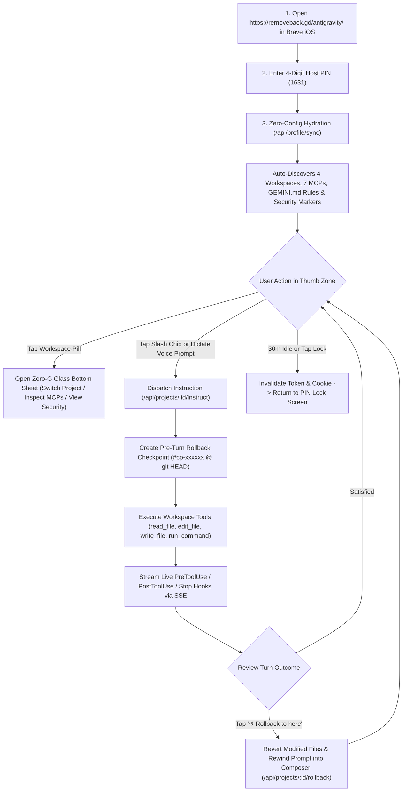
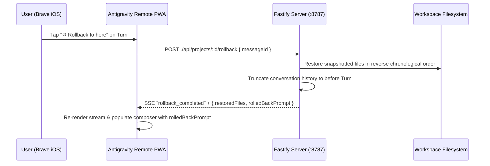

# Antigravity Remote — Mobile UX Brief, User Workflows & Brave iOS Ergonomics

**Version:** `1.1.0`  
**Target Client:** Brave Browser on iOS (iPhone Retina Viewport & Standalone Home Screen PWA)  
**Source Implementation:** [`public/index.html`](../public/index.html) · [`src/profileSync.ts`](../src/profileSync.ts) · [`src/agentEngine.ts`](../src/agentEngine.ts) · [`src/server.ts`](../src/server.ts)

---

## 1. Executive UX Problem Statement

When engineers step away from their desktop workstation, they still need to supervise long-running agentic tasks, verify service health across colocated production nodes, dispatch urgent code fixes, and revert unwanted changes. However, traditional SSH terminals and desktop-first web IDEs fail on mobile devices for five reasons:

1. **Manual Configuration Friction:** Mobile users cannot manually type repository paths, configure MCP JSON files, or paste system prompts on a phone screen.
2. **iOS WebKit & Brave Browser Viewport Shifts:** On iOS, expanding the software keyboard, triggering the native microphone dictation waveform, or collapsing Brave's bottom/top address bars causes standard `100vh` layouts to jump, pushing the navigation header off-screen or hiding the composer behind the keyboard.
3. **Typing vs. Voice Dictation:** Typing complex multi-step engineering instructions on glass keys is slow and error-prone compared to iOS native voice dictation paired with one-tap workflow chips.
4. **Lack of Execution Transparency & Undo Safety:** If a remote prompt only generates chat prose without executing real workspace tools—or conversely, if it modifies files without an immediate way to undo—the user either cannot trust the output or risks breaking production without a keyboard handy.
5. **Brave Shields & iOS Background Suspension:** Brave Shields aggressively blocks third-party requests and cross-site cookies, while iOS immediately suspends backgrounded tabs and drops Server-Sent Events (SSE) sockets when the user switches apps or locks their iPhone.

**Antigravity Remote** solves all five challenges through **Zero-Config Gemini Profile Hydration**, **Brave iOS `visualViewport` Pinning**, **Voice-First Slash-Chip Ergonomics**, **Real Workspace Tool Execution**, **One-Tap Antigravity Rollbacks**, and **30-Minute Sliding Session Protection**.

---

## 2. End-to-End User Workflows & Processes

---

### Workflow 1: Zero-Friction Authentication & Automatic Gemini Profile Hydration

**User Goal:** Log in from Brave on iPhone and immediately see all active coding projects, MCP servers, and personal `GEMINI.md` rules without manual setup.

1. **Entry & Home Screen Installation:**
   - The user navigates to `https://removeback.gd/antigravity/` (or `https://binaryday.app/antigravity/`) in Brave on iOS.
   - Tapping **Share → Add to Home Screen** installs the standalone PWA (`display: "standalone"`, `start_url: "/antigravity/"`) using the server-generated `180×180` Retina `apple-touch-icon.png`.
2. **Host PIN Verification:**
   - The user enters the 4-digit **Host Access PIN (`1631`)** on the `#login-screen` (`inputmode="numeric"` brings up the large iOS numeric keypad; `font-size: 16px` prevents page zoom).
   - Because the host's `GEMINI_API_KEY` is already bound on the Vast.ai server, the optional API key override field can be left blank.
3. **Zero-Config Hydration (`POST ./api/auth/login` → `GET ./api/profile/sync`):**
   - The microserver verifies connectivity to `gemini-3.5-flash` via `@google/genai`, issues a dual-persisted session token (`HttpOnly; Secure; SameSite=Strict; Path=/antigravity` cookie + `localStorage` Bearer JWT fallback), and introspects the host environment:
     - **Hydrated User Identity:** `jbb@avilo.capital` on `mac-mighty-vertex` (`dfd5c73f-d7c2-4750-bd4e-3e24c72f1604`).
     - **4 Auto-Discovered Colocated Workspaces:**
       1. `AntigravityRemote` (`/workspace/antigravity-remote` · `:8787` · `CPU Only / 0B VRAM`)
       2. `RemoveBackGround` (`/workspace` · `:7861` · `PG: removebg · Redis DB 2 · 100% RTX 4060 Ti cuda:0`)
       3. `BinaryDay` (`/workspace/binaryday` · `:4001` · `PG: binaryday · Redis DB 0 · 0B VRAM`)
       4. `SnapCal` (`/workspace/snapcal` · `:4002` · `PG: snapcal · Redis DB 1 · 0B VRAM`)
     - **7 Linked MCP Servers:** `Vast.ai Compute Node`, `Cloudflare Edge & Tunnels`, `OVHcloud Registrar & DNS`, `GitHub Repositories & PRs`, `Google Stitch Design System`, `Resend Transactional Email`, and `Stripe Billing & Webhooks`.
     - **3-Tier Memory Rules:** Hydrates Tier 1 (`~/.gemini/GEMINI.md`) and Tier 2 (`.agents/rules/infra.md`) guardrails directly into the agent context and UI switcher.

---

### Workflow 2: Thumb-Zone Workspace, MCP & Security Switching

**User Goal:** Switch between the 4 colocated repositories or audit MCP/security state with one thumb without triggering Brave's native edge-swipe navigation.

1. **Persistent Top Workspace Pill (`#workspace-pill-btn`):**
   - Displays the active project name (`AntigravityRemote`), live **Orbital Status Dot** (`Idle`, `Running`, `Completed`, `Blocked`), active git branch (`git:main`), and synced MCP count (`7 MCPs`).
2. **Hardware-Accelerated Bottom Sheet (`#bottom-sheet`):**
   - Tapping the workspace pill slides up a `translate3d(0, 0, 0)` Zero-G Glass bottom sheet (`max-height: 82dvh`) with three thumb-friendly pill tabs:
     - **Tab 1 — `Workspaces`:** Lists all 4 Vast.ai projects with live local port health probes (`● :8787 healthy`, `● :7861 healthy`, `● :4001 healthy`, `● :4002 healthy`), workspace path, latest git commit SHA, and Tier 2 resource allocation. Tapping any project switches the active conversation stream and composer target immediately.
     - **Tab 2 — `MCPs & Rules`:** Displays connection status, transport type (`Direct Host / SSH`, `Stdio Bridge`, `Synced Profile Bridge`), and tool counts across all 7 MCP servers, followed by the hydrated Tier 1 & Tier 2 `GEMINI.md` rules and `hooks.json` bridge status.
     - **Tab 3 — `Security & Profile`:** Surfaces the authenticated user profile (`jbb@avilo.capital`), host node (`mac-mighty-vertex`), cryptographic markers (`Host PIN + HMAC-SHA256 JWT + HttpOnly Strict Cookie`, `Cloudflare TLS 1.3 → 127.0.0.1:8787`), the 30-minute inactivity policy, and an immediate **Lock & Log Out Session Now** button.

---

### Workflow 3: Voice-First Prompting & Hydrated Slash-Chip Execution

**User Goal:** Dispatch complex engineering instructions on the go using iOS microphone dictation or single-tap workflow chips.

1. **Hydrated Slash/Prompt Chips (`.chips-scroll`):**
   - Directly above the input box, a horizontally scrollable row presents 6 profile-hydrated workflow chips inset `24px` from screen edges:
     - `✦ /start · Bootstrap Context`
     - `✦ Verify Health & Typecheck`
     - `✦ Audit Cluster & GPU VRAM`
     - `✦ Sync & Reload Caddy`
     - `✦ /update-memory · Save State`
     - `✦ /plan · Architecture Spec`
   - Tapping any chip populates the `<textarea>`, auto-resizes the input container, and focuses the cursor so the user can either tap **Send** immediately or append voice details.
2. **iOS Native Dictation Optimization:**
   - The `<textarea id="prompt-input">` is configured with `autocorrect="on"`, `autocapitalize="sentences"`, `spellcheck="true"`, `enterkeyhint="send"`, and `font-size: 16px`.
   - When the user taps the iOS keyboard microphone icon and speaks, the textarea auto-expands up to `112px` (`autoResizeTextarea()`), and a single-tap **`Clear`** button (`#clear-input-btn`) appears inside the right edge of the input box if they want to discard and re-dictate.

---

### Workflow 4: Real-Time Agentic Tool Execution & Hook Telemetry

**User Goal:** Have remote instructions actually inspect files, edit code, and run verification commands inside the target workspace while watching live progress on the iPhone.

1. **Workspace Tool Loop (`src/agentEngine.ts`):**
   - When `POST ./api/projects/:id/instruct` is called, the server transitions the project's orbital dot to **`Running`** (pulsing purple) and invokes `gemini-3.5-flash` with four sandboxed workspace tools bound to `project.workspacePath`:
     - `read_file({ relativePath })`
     - `edit_file({ relativePath, search, replace })`
     - `write_file({ relativePath, content })`
     - `run_command({ command })` (protected by Tier 2 cluster guardrails blocking `supervisorctl restart all` or destructive root commands).
2. **Dual-Source Hook Telemetry (`PreToolUse`, `PostToolUse`, `Stop`):**
   - Every tool invocation inside `agentEngine.ts` **and** any external CLI/IDE tool triggered via `~/.gemini/config/hooks.json` (`scripts/hooks-bridge.sh`) emits real-time SSE `hook_event` frames.
   - The **Live Hook Strip** (`#live-hook-strip`) at the top of the conversation feed updates instantaneously (e.g., `PreToolUse · read_file: Running read_file(package.json)` → `PostToolUse · edit_file: Edited src/server.ts (checkpoint saved for rollback)`), and the full trace list is persisted inside the assistant message card.

---

### Workflow 5: Antigravity Checkpoints & One-Tap Rollbacks (`↺ Rollback to here`)

**User Goal:** Undo an instruction turn—reverting both the workspace file modifications on disk and the conversation history—with a single tap, identical to the desktop Antigravity IDE.

1. **Automatic Pre-Turn Checkpoint Creation:**
   - At the start of every instruction turn, `dispatchProjectInstruction()` generates a unique checkpoint ID (`#cp-xxxxxx`) stamped with the current git branch and short commit SHA (`git rev-parse --short HEAD`).
   - Before `edit_file` or `write_file` modifies any file in `project.workspacePath` for the first time during that turn, `snapshotBeforeWrite()` records `{ relativePath, existed, originalContent }` into `checkpoint.modifiedFiles`.
2. **One-Tap Rollback Execution:**
   - Every message turn card (after the initial welcome card) displays a dashed `.rollback-bar` footer showing `⚓ #cp-xxxxxx · HEAD`, the count of snapshotted files (`(N files snapshotted)`), and the **`↺ Rollback to here`** button.
   - Tapping **`↺ Rollback to here`**:
     1. Calls `POST ./api/projects/:id/rollback` with `{ messageId }`.
     2. Restores all files modified during or after that turn in **reverse chronological order** (writing back `originalContent` or removing newly created files).
     3. Removes the rolled-back turn(s) from `data/store.json` and broadcasts `rollback_completed` via SSE.
     4. Automatically places the rolled-back user prompt back into the `<textarea id="prompt-input">` so the user can refine their wording and re-send without retyping.

---

### Workflow 6: Session Security Visibility & 30-Minute Inactivity Auto-Logout

**User Goal:** Verify at a glance which profile is logged in, confirm that transport and session tokens are protected, and ensure unattended mobile sessions automatically lock after 30 minutes of inactivity.

1. **Persistent Security & Identity Bar (`#security-bar`):**
   - Always visible beneath the top navigation bar, displaying:
     - `👤 jbb@avilo.capital · mac-mighty-vertex` (Authenticated profile & host node)
     - `🛡️ TLS 1.3 · HMAC-JWT · Loopback :8787` (Security markers)
     - `⏱ 30:00` (Live sliding inactivity countdown timer)
   - Tapping any badge in `#security-bar` opens the **Security & Profile** tab in the Bottom Sheet with full cryptographic and sandbox details.
2. **Dual-Layer 30-Minute (`1800s`) Sliding Inactivity Auto-Logout:**
   - **Client-Side Activity Monitor:** Listeners on `pointerdown`, `keydown`, `touchstart`, and `scroll` reset `lastActivityTs = Date.now()`. Every second, the UI updates `#inactivity-countdown` (`29:59`, `29:58`, ...). If `30:00` (`1800s`) elapses without interaction—or if Brave wakes from iOS background suspension (`visibilitychange`) after >30 minutes—the client calls `POST ./api/auth/logout`, clears `localStorage`, closes the SSE stream, and presents the PIN lock screen with `"Logged out automatically after 30 minutes of inactivity."`
   - **Server-Side Session Registry (`sessionRegistry`):** Every authenticated API request calls `verifyAndTouchSessionToken()`. If `Date.now() - rec.lastActivityAt > 30 * 60 * 1000`, the server deletes the session, adds the token to `revokedTokens`, clears the `ag_session` cookie, and returns `HTTP 401`.
   - **Manual Instant Lock (`#logout-btn`):** A dedicated padlock button in the top-right navigation bar (and inside the Security sheet) lets the user lock and revoke the session immediately at any time.

---

## 3. Brave iOS Ergonomics & WebKit Engineering Matrix

| Mobile UX Challenge on Brave iOS | Engineering Solution Implemented in [`public/index.html`](../public/index.html) |
| :--- | :--- |
| **Keyboard & Dictation Waveform Pushing Header Off-Screen** | `#app-shell` is pinned to `top: var(--vvo); height: var(--vvh);` updated in real time by `window.visualViewport` `resize` and `scroll` listeners (`syncVisualViewport()`). |
| **WKWebView Pull-to-Refresh & Elastic Rubber-Banding** | `html, body` enforce `position: fixed; width: 100%; height: 100dvh; overflow: hidden; overscroll-behavior-y: none;`. Scrolling is isolated strictly inside `.stream-container` and `.sheet-content` (`-webkit-overflow-scrolling: touch; overscroll-behavior-y: contain`). |
| **iOS Auto-Zoom on Input Focus** | Both `#prompt-input` and `.text-field` enforce `font-size: 16px` (`1rem`), preventing WebKit from zooming the page when the user taps into an input. |
| **iPhone Notch, Dynamic Island & Home Indicator Clipping** | Top bar uses `padding-top: calc(env(safe-area-inset-top, 0px) + 8px)`; composer dock and bottom sheet use `padding-bottom: max(env(safe-area-inset-bottom, 0px), 12px)`. |
| **Brave iOS Back/Forward Edge Swipe Collisions** | `.top-nav`, `.security-bar`, `.stream-container`, `.composer-dock`, and `.sheet-tabs` maintain a `24px` horizontal padding buffer from the left and right screen edges. |
| **iOS Tab Backgrounding & SSE Drop** | `document.addEventListener('visibilitychange')` and `window.addEventListener('pageshow')` check the 30-minute inactivity window and immediately trigger `syncProfile()` + `connectSse()` when Brave returns to the foreground. |
