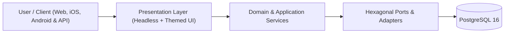

<!-- antigravity-doc-sync -->
# 🧩 antigravity-remote — Logical Architecture (`docs/architecture/LOGICAL_ARCHITECTURE.md`)

> **Index**: [`docs/INDEX.md`](../INDEX.md) · **Memory Baseline**: [`memory-bank/projectbrief.md`](../../memory-bank/projectbrief.md)

## 1. System Context & Domain North Star
- **Project**: **antigravity-remote** — Antigravity Remote — Self-Hosted Mobile Companion & Gemini Profile Auto-Discovery Microserver for Brave iOS
- **Target Platforms**: Web, iOS, Android & API
- **Core Architectural Pattern**: Three-Tier Memory Bank + Decoupled Zero-Token Backlog + Hexagonal Domain/Adapter Isolation.

---

## 2. Core Domain Entities & Shared Hexagonal Bricks

<!-- ag-section:logical-entities:start -->
| Module / Brick | Responsibility | Status |
| :--- | :--- | :--- |
| `core` | Primary domain & application services | 🟢 Active |
<!-- ag-section:logical-entities:end -->

---

## 3. Progressive Feature & Capability Map (`FEAT-*`)

<!-- ag-section:logical-features:start -->
| Feature ID | Capability / Title | Status | Target Components |
| :--- | :--- | :--- | :--- |
| **`FEAT-101`** | Official Antigravity Zero-G Glass UI & 2x2 SSAA Retina PNG Icons | 🟢 DONE | `src/icons.ts`, `public/index.html`, `public/manifest.json` |
| **`FEAT-102`** | Zero-Config Gemini Profile Hydration & 7 MCP Auto-Discovery | 🟢 DONE | `src/profileSync.ts`, `src/server.ts` |
| **`FEAT-103`** | Real Workspace Tool Execution & One-Tap Antigravity Rollbacks | 🟢 DONE | `src/agentEngine.ts`, `src/store.ts`, `public/index.html` |
| **`FEAT-104`** | User Profile Security Markers Bar & 30-Minute Inactivity Auto-Logout | 🟢 DONE | `src/server.ts`, `public/index.html` |
| **`FEAT-105`** | Interactive File Diff Viewer Modal on Checkpoint Cards | 📋 TODO | `src/store.ts`, `public/index.html` |
| **`FEAT-106`** | One-Tap Git Commit & Push Action from Mobile Turn Card | 📋 TODO | `src/server.ts`, `public/index.html` |
<!-- ag-section:logical-features:end -->

---

## 4. Consolidated Project Specifications

<!-- ag-section:legacy-logical:start -->
<!-- harvested-repo-context:start -->
### Harvested Repository & Memory-Bank Context

- **From [`memory-bank/projectbrief.md`](../../memory-bank/projectbrief.md) (Memory Bank Baseline)**:
  - **Product Name**: Antigravity Remote (`v1.1.0`)
  - **Repository**: `https://github.com/johnny-saigon/antigravity-remote`
  - **Tagline**: Self-Hosted Microserver & Mobile-First Web Client for Brave Browser on iOS — styled with official Antigravity Zero-G Glass branding, powered by Zero-Config Gemini Profile Hydration (`@google/genai`), equipped with real workspace tool execution (`read_file`, `edit_file`, `write_file`, `run_command`), Antigravity Checkpoints & One-Tap Rollbacks, and protected by a 30-minute sliding inactivity auto-logout.
  - **Canonical Docs**: @[Brand Book](../docs/design/BRAND_BOOK.md) · @[UX Brief](../docs/design/UX_BRIEF.md) · @[Architecture](../docs/architecture/TECHNICAL_ARCHITECTURE.md)
  - **Primary Client**: Brave Browser on iOS (`100dvh` + `window.visualViewport` pinned PWA with `180×180` SSAA Retina `apple-touch-icon.png`).
<!-- harvested-repo-context:end -->
<!-- ag-section:legacy-logical:end -->
